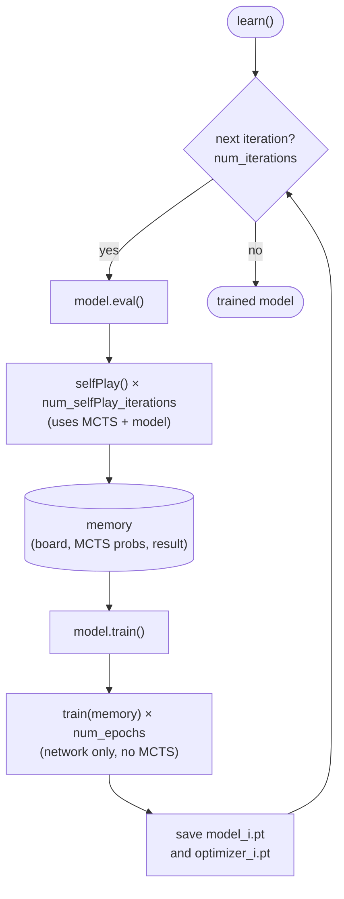
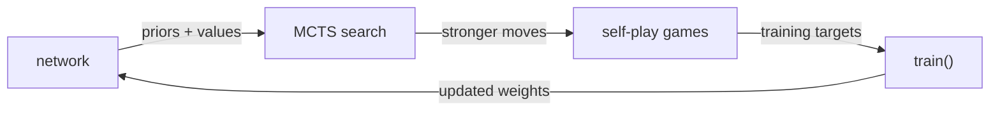
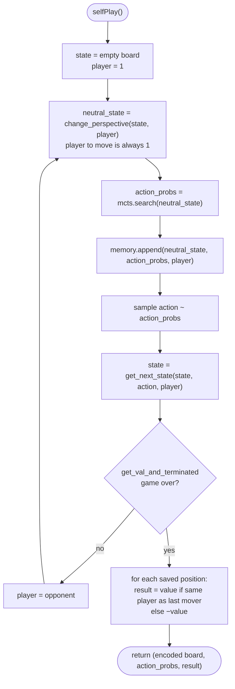
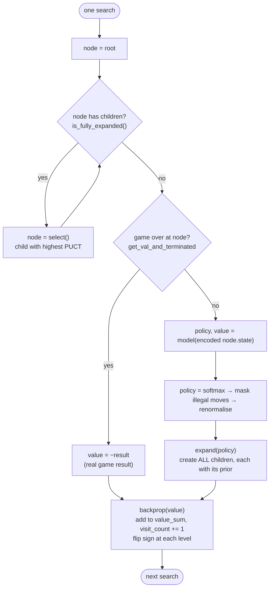
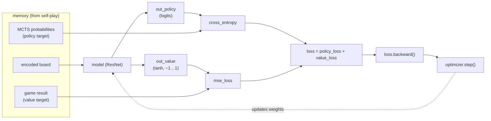
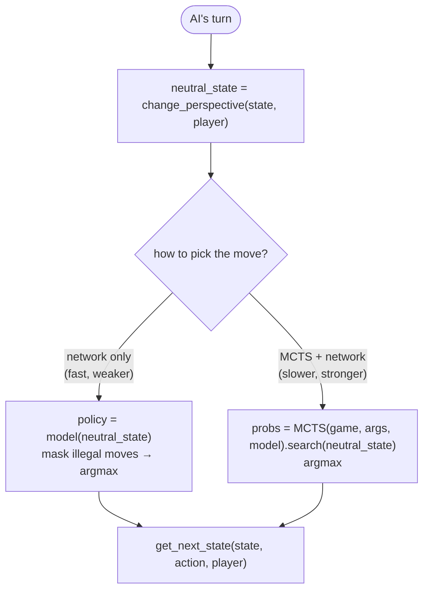
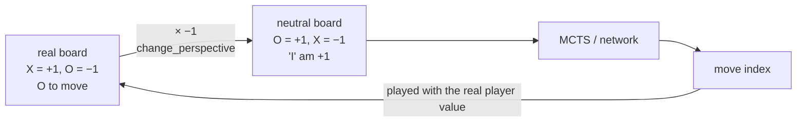

# AlphaZero Pipeline: Flowcharts

These diagrams show how the pieces in `tictactoe.ipynb` fit together. The Go version in `Modules/` follows the same structure on a larger board.

The diagrams use [Mermaid](https://mermaid.js.org/). They render on GitHub and in VS Code's Markdown preview (with a Mermaid extension).

---

## 1. The whole training loop

`learn()` alternates between two phases: self-play, which generates data, and training, which updates the network. MCTS runs only during self-play.



The cycle that makes it improve:



---

## 2. Self-play: one game

The AI plays both sides. Each position is saved, and once the game ends, every saved position is labelled with the result from the point of view of the player who was to move there.



Example of how the results are assigned (X wins on the 5th move):

| Move | To play | Result stored |
|------|---------|---------------|
| 1    | X       | +1            |
| 2    | O       | −1            |
| 3    | X       | +1            |
| 4    | O       | −1            |
| 5    | X       | +1            |

---

## 3. MCTS: one search (the AlphaZero version)

`search()` repeats this `num_searches` times, then returns the visit counts of the root's children as probabilities.



Selection score for each child (PUCT):

```
q     = 1 − ((child.value_sum / child.visit_count) + 1) / 2      # 0 if unvisited
score = q + C · child.prior · √(parent.visit_count) / (1 + child.visit_count)
```

* `q` is how good the move has been so far, converted to the parent's point of view and scaled to [0, 1].
* The second term is an exploration bonus. It is largest for moves the network likes (high prior) that haven't been visited much.

### How it differs from the random-rollout MCTS

| Step       | Random-rollout MCTS (`MCTSrandom`) | AlphaZero MCTS (`MCTS`)                  |
|------------|------------------------------------|------------------------------------------|
| Expand     | one random untried move per search | all legal moves at once, with priors     |
| Evaluate   | random playout to the end          | network value head                       |
| Select     | UCB: `q + C·√(ln N / n)`           | PUCT: `q + C·P·√N / (1 + n)`             |

---

## 4. Training: where the losses come from

MCTS does **not** appear here. By the time `train()` runs, MCTS has finished, and its output is stored data. Gradients flow only through the network.



* **Policy loss**: learn to suggest the moves that the search ended up preferring.
* **Value loss**: learn to predict who wins from this position.

---

## 5. Playing against the trained model

The trained model is **just the network**. You can use it on its own, or wrap it in MCTS (which is how AlphaZero plays).



---

## 6. The board is always seen from "my" point of view

Every node and every network input treats the player to move as `+1` and the opponent as `−1`. This lets one network play both sides.



Because each tree level is the opposite player, values are flipped in two places:

* in **`backprop`**: `−value` is passed up to the parent;
* in **`get_ucb`**: `1 − …` converts the child's score into the parent's point of view.
