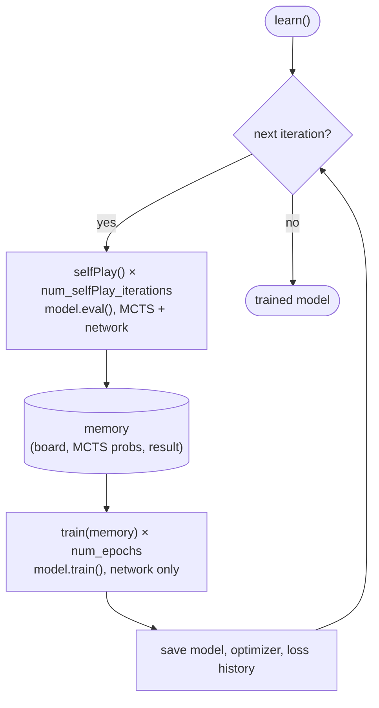
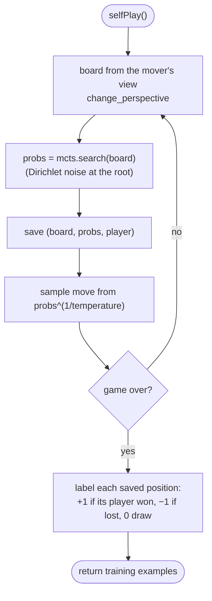
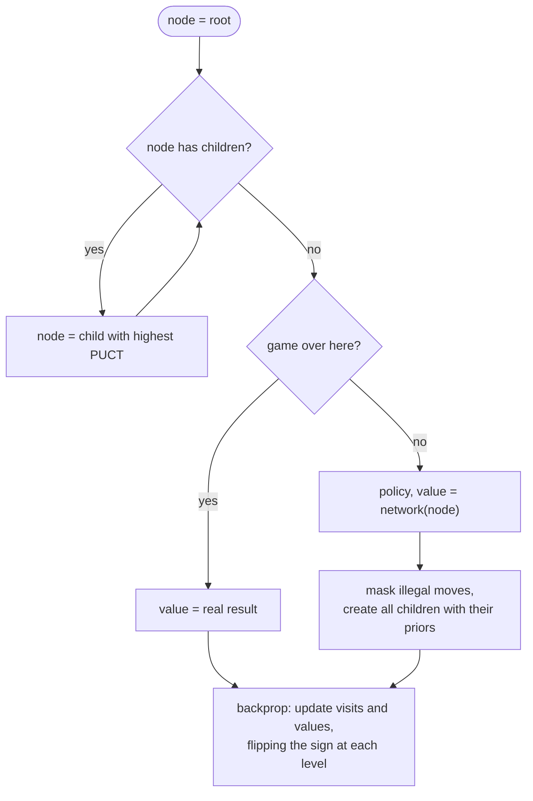
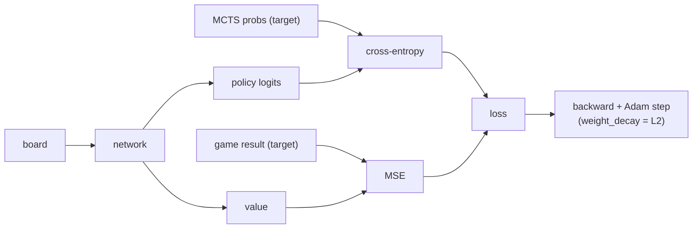
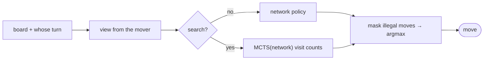

# AlphaZero Pipeline

Diagrams of the pipeline in `TicTacToe.ipynb`. The Go version uses the same structure. The diagrams use [Mermaid](https://mermaid.js.org/), which GitHub renders automatically.

## 1. Training loop

MCTS runs only during self-play. Training uses only the network and the stored data.



## 2. Self-play: one game



## 3. MCTS: one search

`search()` repeats this `num_searches` times, then returns the root's visit counts as probabilities.



```
PUCT = q + C · prior · √(parent visits) / (1 + child visits)
q    = 1 − (child's average value + 1) / 2      (the child's value, from the parent's view)
```

## 4. Where the losses come from



## 5. Playing and evaluation

The trained model is just the network. It can play on its own, or guide MCTS (stronger).


